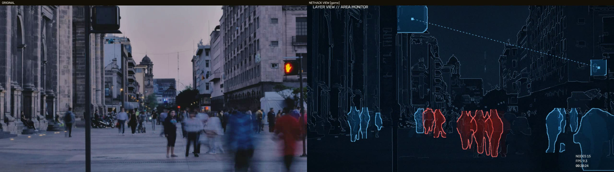
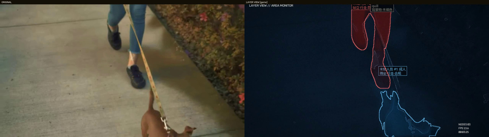

# Watch Dogs 2 Vision — NetHack Layer View

> **中文**：本项目参考了《看门狗2》（Watch Dogs 2）中"NetHack 骇客视角"的设计理念，但核心观念与应用场景是独立区分的。它的目标用途是：当未来智能化设备全面覆盖时，把这种"图层视角"加载到监控摄像头、AR 眼镜、手机等各种观测终端上——在监控视角下实时检测、识别、高亮显示当前环境中**有无异常人员、异常电子设备、异常物品进入**，并对识别结果进行分析；后期还可通过其他探测渠道（如电气线路扫描）扩展到信息安全态势感知方向。
>
> **English**: Inspired by the "NetHack view" design in *Watch Dogs 2* (Ubisoft) — while the core concept and application here are independent and distinct. The vision: as smart devices become ubiquitous, this layer view can run on surveillance cameras, AR glasses, phones and other terminals — highlighting, detecting, recognizing and analyzing **abnormal people, unauthorized electronic devices, and suspicious objects** entering the monitored scene in real time. Future extensions may include probing electrical/network lines and information-security situational awareness via other sensing channels.
>
> *《看门狗2》及其美术设计版权归 Ubisoft 所有。本项目仅为技术理念参考与学习用途，与育碧官方无关。 / Watch Dogs 2 and its artwork are property of Ubisoft. This project is an independent technical exploration, not affiliated with Ubisoft.*

把《看门狗2》里的 **NetHack 透视视角**带到现实：给任何监控画面/视频套上一层语义图层，
人和设备按身份**整体剪影变色**（蓝 = 合规/内部，红 = 异常/外部），背景只留深灰蓝轮廓。




## 特性

- **图层视角渲染**：深蓝数字世界 + 钢蓝结构线，识别到的目标以真实剪影整体标色（非拉框）
- **实例分割**：YOLOv8n-seg（ONNX），人/动物/电子设备都是真实轮廓
- **人脸库**：YuNet + SFace 人脸识别，录入内部/外部人员，画面里直接显示姓名并标色
- **1000 类细识别**：MobileNetV2 对每个目标二次识别（茶杯、卫星天线、投影仪…），自动纠正"误认成人"
- **设备白名单**：合规设备标蓝，未知设备标红并自动记入异常
- **异常记录**：未知人员/设备自动截图入库，事后一键归档（标为内部人员/加入白名单）
- **桌面工具**：PyInstaller 单文件 exe，选视频 → 转换 → 自动输出，无后台服务

## 快速开始

### 方式一：直接用 exe（Windows）
从 Releases 下载 `NetHackConverter.exe`，双击运行。

### 方式二：源码运行
```bash
pip install opencv-python numpy onnxruntime pyyaml pillow pywebview pyinstaller
python server.py          # 浏览器版工具
# 或命令行：
python run.py --source your_video.mp4 --compare --display
```

模型文件（放入 `models/`）：
- `yolov8n-seg.onnx` — 实例分割
- `face_detection_yunet_2023mar.onnx` / `face_recognition_sface_2021dec.onnx` — 人脸库（[opencv_zoo](https://github.com/opencv/opencv_zoo)）
- `mobilenetv2-7.onnx` + `imagenet_classes.txt` — 细识别（[onnx/models](https://github.com/onnx/models)）

## 项目结构

| 文件 | 职责 |
|------|------|
| `run.py` | 管线入口：读流 → 检测 → 跟踪 → 渲染 → 输出 |
| `detect.py` | YOLOv8n-seg ONNX 检测 + 掩码 |
| `track.py` | IoU 跟踪器 + 掩码时序平滑 |
| `style.py` | L1 底图调色 + L2 结构轮廓线 |
| `overlay.py` | L3 剪影标色 + 标注牌 + L4 设备链路 |
| `hud.py` | L5 噪点/暗角/HUD |
| `face.py` | YuNet 人脸检测 + SFace 特征匹配 |
| `labeler.py` | MobileNetV2 千类细识别 + 中文名映射 |
| `library.py` | 人脸库/设备白名单/异常记录持久化 |
| `server.py` / `desktop.py` | 转换工具（HTTP + pywebview 桌面壳） |

## License

MIT
